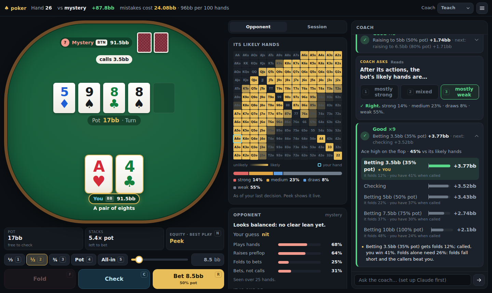
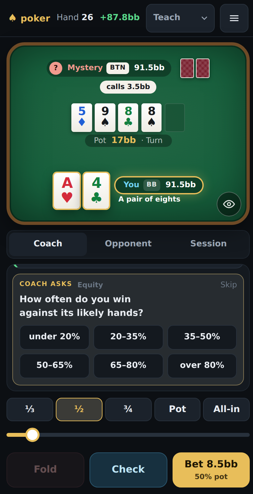

<h1 align="center">♠ poker</h1>

<p align="center">
  <strong>A heads-up No-Limit Hold'em trainer that runs in your browser.</strong><br>
  Play the kinds of player you meet at a home game, with a coach that teaches you to read and beat each one.
</p>

<p align="center">
  <a href="https://github.com/pungoyal/poker/actions/workflows/ci.yml"></a>
  <a href="#licence"></a>
  
</p>

<p align="center">
  
  
</p>

---

A trainer for getting better at heads-up No-Limit Hold'em. You play the four
kinds of player every home game has (a sound regular, a calling station, a nit
and a maniac). By default you are not told which one you face: you read it from
what it does. A coach watches every decision: before you act it asks one quick
question, and after you act it shows what your choice was worth next to the
better options, and why. Your mistakes are tracked across sessions, and the
drill replays the costliest ones as practice.

It is a static web page. The rules engine, the opponents and the coach are
compiled to WebAssembly and run in your browser, on a laptop or a phone, online
or off. Nothing of the game runs on a server and your hands never leave the
device.

## Features

- **Opponents with real leaks.** `solid` is a sound regular that defends
  enough against every bet size that betting any two cards at it does not
  pay. `station` limps and calls far too much, `nit` folds to pressure, and
  `maniac` raises and bluffs too often. Each needs a different game from you.
- **A mystery opponent, by default.** One of the four is chosen in secret. The
  opponent panel shows what it has been seen to do (hands played, raises,
  folds to bets, bets against calls); you work out who it is and adjust. It is
  named when the session ends.
- **A coach that reads the opponent.** Every bot publishes its strategy, so the
  coach narrows the bot's likely hands with each action it takes (Bayes' rule)
  and measures your equity against those hands, not against any two cards. It
  prices every option (fold, check, call and the standard bet sizes) by how
  often the bot folds, how strong the hands that continue are, and what the
  streets still to come add.
- **Questions that follow what you need.** In the default `teach` mode the
  coach asks before a decision: read the bot's range, estimate your equity,
  work out the price, count your outs, or judge how often a bet gets a fold.
  You answer with one tap or a number key. Skills you get wrong come up more;
  a skill you keep getting right comes up less and less, and never twice
  running. Against a mystery opponent it also asks, now and then, who you
  think you are facing.
- **Reviews you can scan.** A sound play gets one line. A mistake opens in
  full: the verdict, what it cost, every option as a bar with yours and the
  best marked, how often each bet gets a fold, and the facts that decided it.
- **The opponent's range, drawn.** A grid of the 169 starting hands, lit by
  how likely each is after everything the bot has done, with your own hand
  marked. In `teach` mode it lags one decision behind so it never answers a
  question for you; Peek shows it live.
- **A table made for the decision.** The cards and the pot on a felt, one tap
  or one key for every action, bet sizes as presets, a slider and an amount.
  A wide screen shows the table, the opponent, the session and the coach side
  by side; a phone keeps the table and the buttons under your thumb and puts
  the rest behind tabs.
- **A session you can leave.** Close the tab mid-hand and the session is
  there when you come back, on the same hand. It works offline once loaded
  and can be added to a phone's home screen.
- **Leaks and drills.** Finished hands are kept in the browser. The menu shows
  your costliest recurring mistakes across sessions and replays them as
  practice spots.
- **An LLM coach.** With your own Anthropic API key, Claude explains every
  full review in its own words and answers your questions, working only from
  the engine's exact numbers.
- **Correct and reproducible.** A deterministic rules engine, a fast
  evaluator and seeded deals: the same seed deals the same session, and a
  saved session is verified hand by hand when it is resumed.

## Quick start

With Docker (nothing else needed):

```sh
git clone https://github.com/pungoyal/poker && cd poker
docker compose up --build
```

Then open <http://localhost:8080>.

With Rust 1.88 or newer:

```sh
rustup target add wasm32-unknown-unknown
cargo install wasm-bindgen-cli --version 0.2.130 --locked
./web/build.sh
python3 -m http.server --directory web/www 8080
```

`web/www` is then a complete static site: copy it to any web host to play from
anywhere. The [Deploy workflow](.github/workflows/pages.yml) publishes it to
GitHub Pages on every push to `main`, once Pages is enabled for the repository
with "GitHub Actions" as its source.

## Playing

Both players start every hand with 100 big blinds and the button alternates.
A new session (in the menu) chooses the opponent, how the coach helps, the
stacks and, if you want the same cards again, a seed.

| Key | Action | Key | Action |
| --- | --- | --- | --- |
| `F` | fold | `R` | bet or raise the amount shown |
| `C` | check or call | `1`–`5` | a third, half, three quarters, the pot, all-in |
| `←` `→` | a smaller or bigger bet | `Space` | next hand |
| `1`–`6` | answer the coach's question | `Esc` | skip the question (or just act) |
| `N` | show or hide the numbers and the live range | `D` | open or close the last review |
| `/` | ask the coach | `?` | help |

The coach works in one of four ways, changed at any time from the top bar:

| Mode | Before you act | After you act |
| --- | --- | --- |
| Teach (default) | a question on some decisions; the numbers stay hidden unless you peek | a review |
| Numbers | your equity, the price of a call and the best play | a review |
| Review | nothing | a review |
| Off | nothing | nothing |

### The coach

The poker engine works out every number; the coach's job is to teach with them,
in as few words as the point needs. After each decision you get a grade, what
it cost, the options side by side with yours, and the facts that decided it.
The top bar keeps the two measures that matter: your result, and what your
mistakes have cost so far (per 100 hands, which is far steadier than your
result). The session panel breaks the cost down by street and by kind of
mistake, and scores the coach's questions by skill.

With an Anthropic API key (Settings), the coach is also Claude
(`claude-opus-5-5` by default). It receives the engine's facts for each
decision (the hand so far, equity, pot odds, the bot's likely hands, the value
of every option and your recurring leaks) and is told to use only those
numbers, lead with the verdict, and cut anything that does not help the
decision. Replies stream into the coach panel. The key is kept in your
browser's storage and sent only to `api.anthropic.com`; each request sends the
current hand's conversation and is billed to your key. Nothing else leaves
your device.

The coach measures in pots, not big blinds. After the flop sizes are shares
of the pot; before it, multiples of the bet faced (2.5x, 3x). Each option is
shown by how far it trails the best, as a share of the pot, and grades follow
that cost: close under 1% of the pot, an inaccuracy under 5%, a mistake under
25%, a blunder beyond. Small pots are graded as if they held at least 5bb
after the flop and 20bb before it, so slips in a pot of blinds are not
overstated. Results and session totals, which add up over many pots, stay in
big blinds.

Values are averages over the bot's likely hands. On the river they are exact.
Before it they add an estimate of the betting still to come: a hand ahead of
what continues gains from later streets, a hand behind pays on them, and before
the flop a weak hand is counted at less than its raw equity. An all-in of more
than twice the pot is priced if you choose it, but is not offered as "best".

### Leaks and drills

Every finished hand is kept in the browser, with the coach's marks. "Leaks and
drills" in the menu adds up your last 300 hands into the mistakes that cost
most, each with the principle that fixes it, and replays the ten costliest
decisions as practice spots: the same cards, the same action so far, and every
option priced once you have chosen.

Settings exports your hands as a file and imports them again, to keep a copy or
move to another device. Each line holds a hand record (the seed, the cards and
every action), which replays to the same result.

## Roadmap

| Step | What | State |
| --- | --- | --- |
| 1 | Rules engine, hand evaluator, hand records | ✅ done |
| 2 | A realistic opponent, and a coach that reads its range and prices every option | ✅ done |
| 3 | Teaching: questions before each decision, an LLM coach, leak tracking and drills | ✅ done |
| 4 | Opponent styles (station, nit, maniac), a mystery opponent to read, one-key questions and scannable reviews | ✅ done |
| 5 | A web front end: the table in the browser, on a laptop or a phone, online or off | ✅ done |
| 6 | Tables of three to nine players, with positions, limpers and multiway pots | planned |
| 7 | Opponents fitted to real players from hands you log after a game | planned |
| 8 | Later streets played out rather than estimated; a solver baseline | planned |

Ideas and help on any of these are welcome: see [Contributing](#contributing).

## Architecture

The library is pure (no I/O, no clocks, no global state). The browser client
compiles it to WebAssembly and sits on top.

| Module | Responsibility |
| --- | --- |
| [`cards`](src/cards.rs) | Cards, the deck and the seeded shuffle |
| [`eval`](src/eval.rs) | Best five-card hand out of five to seven cards; straight and flush draws |
| [`game`](src/game.rs) | Betting rules for one hand as a deterministic state machine |
| [`range`](src/range.rs) | The 1326 two-card combinations, hand strength on a board, ranges and equity against them |
| [`bot`](src/bot.rs) | The `Bot` trait, the playing styles (solid, station, nit, maniac) and the placeholder bots |
| [`coach`](src/coach.rs) | Spot analysis, option values, reviews, questions and the facts given to the LLM |
| [`analysis`](src/analysis.rs) | Re-running the coach over past hands; leaks and drill spots |
| [`session`](src/session.rs) | A session against a bot: deals, the bot's range, what it has been seen to do, score and leaks |
| [`history`](src/history.rs) | Hand records, storage and replay verification |
| [`text`](src/text.rs), [`chat`](src/chat.rs) | Words for actions; the conversation with the LLM coach |
| [`web/src`](web/src) | The table behind the page: commands in, a view out, as JSON across the WebAssembly boundary |
| [`web/www`](web/www) | The page: plain HTML, CSS and JavaScript modules, with no build step or dependencies of its own |

The page never computes poker. A worker holds the table; the page sends it
commands (`act`, `answer`, `next`) and draws the view that comes back. What the
engine leaves to its host is all the page does: timing, storage, keys and the
call to Claude. A session is saved as its seed and the player's actions, and
resumed by replaying them.

A bot implements one trait. `tendencies` describes its strategy (its chances
of folding, calling and raising with any hand), which is what lets the coach
read its range:

```rust
pub trait Bot {
    fn name(&self) -> &'static str;
    /// Chooses an action for `seat`, which is the player to act.
    fn act(&mut self, state: &HandState, seat: usize) -> Action;
    /// How it plays the player to act in `state` when holding `hole`.
    fn tendencies(&self, state: &HandState, hole: [Card; 2], strengths: &Strengths) -> Mix;
    // Optional: its bet size, and a describable style.
}
```

## Development

```sh
cargo test                                   # unit tests: the engine and the table behind the page
cargo clippy --all-targets -- -D warnings    # lints
./web/build.sh                               # build the page into web/www
docker compose run --rm --build test         # everything CI runs, in Docker
```

The toolchain is pinned with [mise](https://mise.jdx.dev) (`mise install`).
See [CONTRIBUTING.md](CONTRIBUTING.md) for the full workflow.

## Contributing

Contributions of all sizes are welcome. Please read the
[contributing guide](CONTRIBUTING.md) and the [code of conduct](CODE_OF_CONDUCT.md).
Report security issues privately as described in [SECURITY.md](SECURITY.md).

## Licence

Licensed under either of

- Apache License, Version 2.0 ([LICENSE-APACHE](LICENSE-APACHE))
- MIT licence ([LICENSE-MIT](LICENSE-MIT))

at your option.

Unless you explicitly state otherwise, any contribution intentionally submitted
for inclusion in this work, as defined in the Apache-2.0 licence, shall be dual
licensed as above, without any additional terms or conditions.
